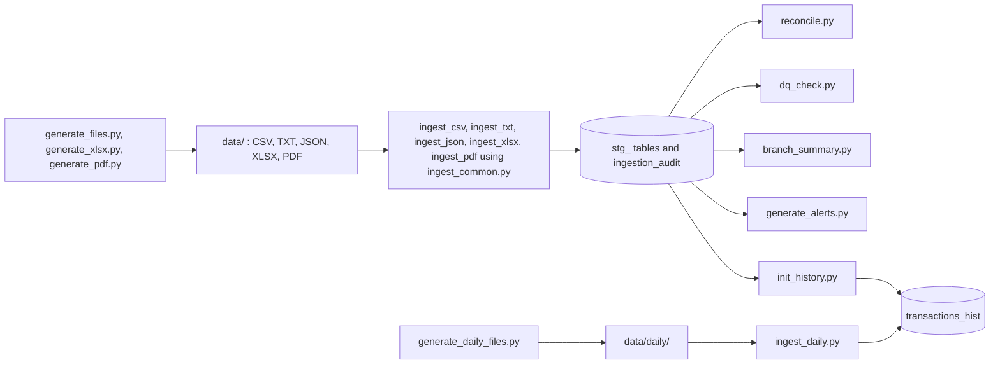

# Bank Data Ingestion Practice

A practice project that follows the working routine of a banking data team: files arrive in several formats, are loaded into database tables, checked, reported on and promoted through Dev, Test and Prod, and every change goes through an issue, a branch and a reviewed pull request.

**What this is:** a learning project built on generated sample data (1000 sample transactions and one sample account statement).

**What it is not:** real bank data, a production system or a scheduler. See "Limitations and open items" at the end.

## Architecture



Tables: `stg_csv`, `stg_txt`, `stg_json`, `stg_xlsx`, `stg_pdf` (staging), `ingestion_audit` (one row per load), `dq_results` (data quality history), `alerts` and `transactions_hist` (daily history).

## What each script does

| Script | Purpose |
|---|---|
| `src/generate_files.py` | Creates 1000 sample transactions (fixed seed) as CSV, pipe-delimited TXT and JSON in `data/` |
| `src/generate_xlsx.py` | Converts the CSV into an Excel file |
| `src/generate_pdf.py` | Creates a text-based account statement PDF for the busiest account |
| `src/db.py` | Database connection; `APP_ENV` (dev, test or prod) selects the settings file |
| `src/ingest_common.py` | Shared ingestion logic: row validation with readable messages, one transaction per load, count check, audit log |
| `src/ingest_csv.py`, `src/ingest_txt.py`, `src/ingest_json.py`, `src/ingest_xlsx.py`, `src/ingest_pdf.py` | One loader per file format; each loads its own `stg_` table (the PDF loader also reconciles against the count stated in the PDF) |
| `src/reconcile.py` | 11 read-only PASS/FAIL checks across the staging tables and the audit log |
| `src/dq_check.py` | Rule-based data quality check (errors and warnings); results are stored in `dq_results` |
| `src/branch_summary.py` | Branch daily summary report with tie-outs, written to `reports/` |
| `src/generate_alerts.py` | Alerts for large transactions and unusual daily activity; safe to re-run |
| `src/init_history.py` | One-time seed of `transactions_hist` from `stg_csv` |
| `src/generate_daily_files.py` | Three deterministic daily files with new rows, late arrivals, identical resends and corrections |
| `src/ingest_daily.py` | Incremental load of one daily file into `transactions_hist` |

## Repository layout

```
src/            Python scripts
docs/           environments.md (promotion routine), compare_environments.sql
data/           generated sample files (not committed)
reports/        generated reports (not committed)
.env.example    template for the settings files (placeholders only)
requirements.txt
```

## Setup (Windows, PowerShell)

Needs Python 3 (developed with 3.14.7), Git and a MySQL server (developed against a local MySQL 9.5).

```
git clone <repository-url>
cd <repository-folder>
python -m venv .venv
.\.venv\Scripts\Activate.ps1
python -m pip install -r requirements.txt
```

Create the Dev database in any MySQL client:

```
CREATE DATABASE bank_dev;
```

Create the Dev settings file from the template and fill in your own values. This file is ignored by Git and must never be committed or shared:

```
Copy-Item .env.example .env.dev
notepad .env.dev
```

Check the connection:

```
python src\db.py
```

Expected: `Connected to dev database bank_dev (server version ...)`.

## Run (Dev)

Run from the repository root, in this order:

```
python src\generate_files.py
python src\generate_xlsx.py
python src\generate_pdf.py
python src\ingest_csv.py
python src\ingest_txt.py
python src\ingest_json.py
python src\ingest_xlsx.py
python src\ingest_pdf.py
python src\reconcile.py
python src\dq_check.py
python src\branch_summary.py
python src\generate_alerts.py
python src\init_history.py
python src\generate_daily_files.py
python src\ingest_daily.py data\daily\transactions_2026-12-01.csv
python src\ingest_daily.py data\daily\transactions_2026-12-02.csv
python src\ingest_daily.py data\daily\transactions_2026-12-03.csv
```

Expected: every ingest prints `SUCCESS` (1000 rows each, 20 rows for the PDF); `reconcile.py` passes 11 of 11 checks; `dq_check.py` reports 0 failed error rules and 1 warning; `generate_alerts.py` creates 40 alerts; the history ends with 1125 rows. The sample data is created with fixed random seeds, so these numbers come from Python 3.14.7; another Python version may produce slightly different data.

All scripts except `src/db.py`, `src/reconcile.py` and the three generators change the selected database, so check which environment is selected before running them.

## Environments

| Environment | Database | Selected by |
|---|---|---|
| Dev | `bank_dev` (local MySQL) | default (no `APP_ENV`) |
| Test | `bank_test` (cloud MySQL) | `APP_ENV=test` |
| Prod | `bank_prod` (cloud MySQL) | `APP_ENV=prod` |

Each environment has its own git-ignored settings file (`.env.dev`, `.env.test`, `.env.prod`). Cloud databases usually need an encrypted connection, set with the optional `DB_SSL_CA` setting (the path to the CA certificate, kept outside the repository).

To run a script against Test:

```
$env:APP_ENV = "test"
python src\db.py
Remove-Item Env:APP_ENV
```

The promotion routine is in `docs/environments.md`: Test first, verify, then Prod; Prod only runs code merged into `main`; read the first printed line (it names the environment) and clear `APP_ENV` afterwards. `docs/compare_environments.sql` compares tables across environments with counts and fingerprints.

## Working method

Every piece of work followed the same routine:

- an issue with business context and acceptance criteria, on a project board
- a branch named `feature/<issue number>-<name>`, created before any change
- small commits, then a pull request that says what changed and how it was tested, reviewed on the Files changed tab before merging
- `Closes #n` when the merge finishes the work and `Refs #n` when more steps remain (for example running in Test and Prod)
- comments on the issue at each stage: start, progress with the exact commands and output, pull request raised, done
- a failure test for every story: break the input on purpose and check that the script fails cleanly and leaves existing data untouched

## What was verified

- The five file formats load the same 1000 transactions: the tables hold identical rows (EXCEPT comparisons in both directions return 0)
- Dev, Test and Prod hold identical data, proven with fingerprints (an MD5 over every row) and not only with row counts
- The reconciliation passes 11 of 11 checks in all three environments
- Failure tests found real gaps that were then fixed: a failed report run left a stale file behind, and an empty table passed as a clean day in the data quality check

## Limitations and open items

- All data is generated sample data; none of it is real
- Nothing is scheduled: every run is manual. A scheduler such as Oozie or Airflow was not built
- Test and Prod are two databases on one cloud server, not separate servers or accounts
- The thresholds in the data quality rules and the alert rules are assumptions that a business owner would have to confirm
- Open issue #35: what should happen to an alert when its source transaction is corrected (decision pending)
- Open issue #38: the audit rows_read is reported inconsistently for some failures, and a procedure for rebuilding the history table is not defined
- The commands are written for Windows PowerShell
